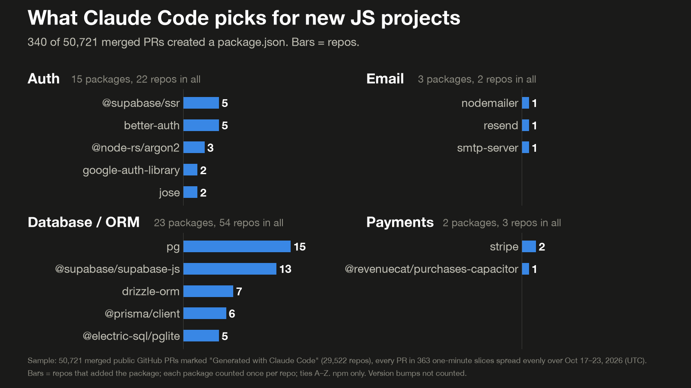
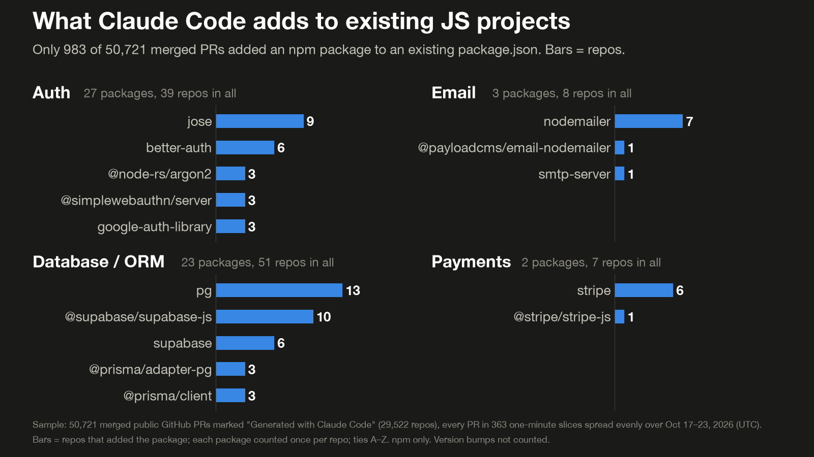

# agent-picks

Which packages does Claude Code actually add to real projects, as opposed to what it picks when you ask it in a prompt? This repo counts them from merged public GitHub pull requests that carry Claude Code's default footer ("Generated with Claude Code"). GitHub search found 1,399,152 such PRs created Oct 17–23, 2026. The sample is every PR in 363 one-minute slices spread evenly over that week: **50,721 PRs from 29,522 repos**. A package counts as added only if it is on a `+` line, not on a `-` line, and really is a dependency in the file after the PR, so version bumps and moves don't count. Each package counts once per repo.

PRs that **create** a dependency file (a new project, or a new app folder in a monorepo) are counted apart from PRs that add a package to a file that already existed.

## Findings

- 5,014 PRs (9.9%) touched a dependency file, but only 1,675 (3.3%, about 1 in 30) added a package. Most dependency edits are version bumps.
- npm: 340 PRs created a new `package.json`, 983 added a package to an existing one.
- **New JS projects**, top packages (repos): typescript 195, @types/node 142, vitest 127, react 100, vite 84, eslint 66, zod 50.
- **Existing JS projects**: vitest 48, zod 38, @playwright/test 30, @types/node 30, jsdom 27, and @axe-core/playwright 17 (accessibility tests).
- Testing: vitest in 127 new projects, jest in 8.
- Payments are rare: `stripe` (npm) was added in 8 repos (6 existing, 2 new) out of 29,522.
- Database: `pg` is the top database package in both groups (15 new, 13 existing), then `@supabase/supabase-js` (13, 10).
- Agent code: `@anthropic-ai/sdk` in 14 existing projects, `@modelcontextprotocol/sdk` in 11.
- **New Python projects** (165 PRs): pytest 58, ruff 28, black 1, flake8 0; fastapi 20, flask 1, django 0.
- Distinct packages: npm 985 in new projects, 1,071 in existing ones (1,618 in either); PyPI 452 and 361 (666 in either).





Full lists, one row per package with repo counts for each group: [`out/picks.csv`](out/picks.csv) (npm) and [`out/picks_python.csv`](out/picks_python.csv) (PyPI). All totals: [`out/summary.json`](out/summary.json). Both groups in one chart: [`out/chart.png`](out/chart.png).

## How it was counted

See [METHOD.md](METHOD.md) for the full rules: how the slices were picked, what counts as "added", new vs existing projects, moved packages, and the limits.

## Run it

Needs Python 3.11+, the GitHub CLI logged in (`gh auth login`), and matplotlib for the charts.

```sh
python3 collect.py --minutes 900 --max-calls 60000 --target-prs 50000   # sample and fetch; writes data/ and cache/
python3 report.py                                                       # counts; writes out/*.csv, out/summary.json
uv run --with matplotlib python chart.py                                # charts; writes out/*.png
```

The collector caps itself at 4,900 REST calls per rolling hour (GitHub allows 5,000), obeys rate-limit headers, and stops on wall time, call count, memory, or `touch out/STOP`. The 50k run took about 5 hours and about 15,400 API calls on one laptop, with a 553 MB response cache. Every response is cached, so a rerun replays from the cache; `python3 collect.py --offline --target-prs 50000` rebuilds the data with no network at all.

To ask a different question, change `PHRASE`, `START` and `DAYS` in `collect.py`, or the category lists in `categories.py`.

The raw per-PR data (`data/`) and the API cache (`cache/`) are not published, because they list other people's PRs. This repo holds the code and the aggregate counts.

## Limits

- It only sees PRs where the default footer was left in. People who remove it, other agents, and commits without a PR are missed.
- Public repos only, mostly small personal projects.
- The footer says Claude Code helped with the PR, not that it chose the package.
- It is a 3.6% sample; packages seen in 1–3 repos may be there by chance.
- Codex has no standard PR marker, so it is left out.
- Dependency lines in unusual formats (multi-line pyproject entries, `-r` includes, git URLs, `setup.py`) are missed.

## Licence

MIT, see [LICENSE](LICENSE). The counts are derived from public GitHub pull requests.
